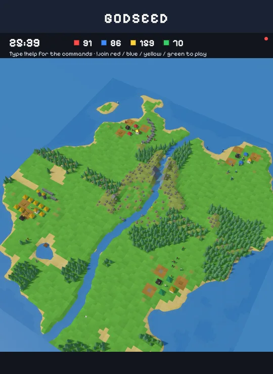
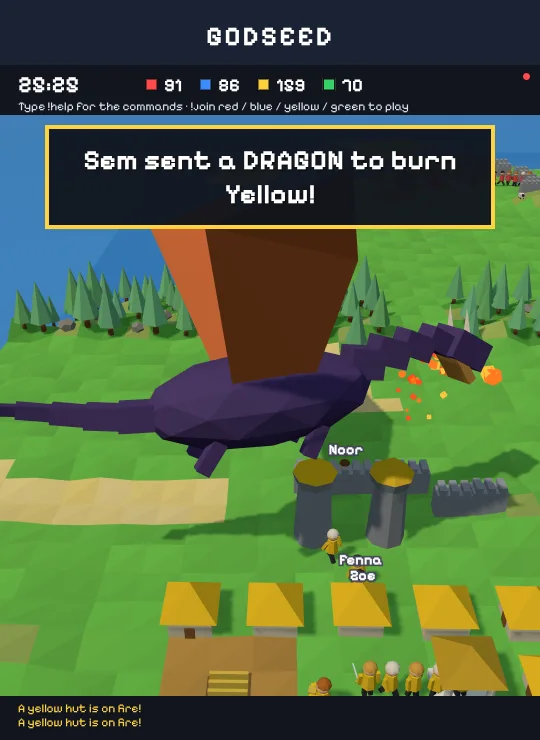
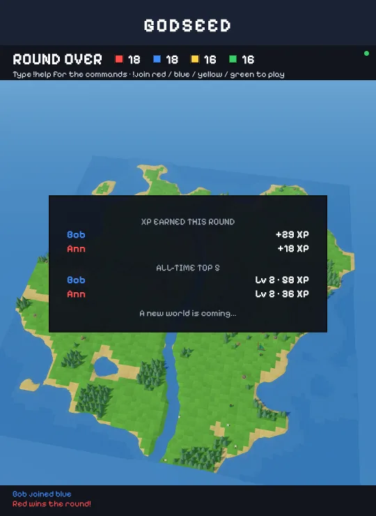

# Godseed

A low-poly 3D god sandbox for TikTok LIVE. Four tribes grow, build and fight on their own; viewers join with `!join`, give their villager orders in chat, and change the world with likes and gifts.

<p>
  
  
  
</p>

## Running it locally

Needs Node 22+ and pnpm.

```bash
pnpm install
pnpm --filter bridge dev    # WebSocket bridge on :8765, plus the test panel's /fake endpoint
pnpm --filter game dev      # the game on http://localhost:5173
```

- `http://localhost:5173/panel.html` is the test panel: fake viewers, chat commands, likes and every gift effect.
- URL options: `?voice=off` (no AI voice), `?sfx=off` (no game sounds), `?speed=20` (fast-forward), `?seed=123` (a fixed world), `?r=pixi` (the old 2D view).
- Keys: `j` fake viewer joins, `g` random gift, `s` start the Final Storm, `r` new world, F3 stats (fps, draw calls), F4 TikTok safe zones.
- `pnpm test`, `pnpm lint` and `pnpm build` run for the whole repo.

## How a round works

- A round lasts 30 minutes; the last 3 are the Final Storm. The tribe with the most points wins, then a new world is made.
- Viewers type `!help` for the commands. A villager that gets no orders works for its tribe by itself.
- XP per round: 3 per kill, 1 per 5 loads brought home, 2 per building, +2 alive at the end, +5 for giving a command, +10 for a win, at most 100. Work you order yourself (`!farm`, `!chop`, `!mine`, `!build`) counts double. Levels change how a villager looks, and the best player of a round stands as a statue in the next world.
- Profiles live in `bridge/data/players.json` and are never wiped automatically. To remove data on purpose: `pnpm --filter bridge remove-player <id>` or `pnpm --filter bridge clear-players` (both ask for "yes").

## Sounds

Game sounds (pops, thunder, the dragon's roar, the level-up fanfare and so on) are made in the browser from tones and noise in `game/src/audio/sfx.ts`: no sound files, nothing to license. Browsers start audio only after a click or key press; for the stream, start Chrome with `--autoplay-policy=no-user-gesture-required` or click the page once.

`prefers-reduced-motion` turns off the screen shake and softens lightning flashes.

## AI voice (optional)

The game reads gifts, new chiefs, joins, viewer kills and the Final Storm aloud with a local [Kokoro](https://github.com/thewh1teagle/kokoro-onnx) voice. It runs on your own PC; nothing goes to the cloud.

```bash
pip install -r tts/requirements.txt
python tts/server.py            # first start downloads the model (~350 MB)
```

Then open the game as usual. The default voice is bm_george; pick another with `?voice=am_michael`, or silence it with `?voice=off`. Without the voice server the game simply stays quiet.

A normal browser tab only plays sound after you click the page once (or with Chrome's `--autoplay-policy=no-user-gesture-required`); an OBS browser source plays it right away.

## Going live on TikTok

1. Put your TikTok name in `.env` (copy `.env.example`): `TIKTOK_USERNAME=yourname`, without the `@`. `TIKTOK_SIGN_API_KEY` is optional; a free [Euler Stream](https://www.eulerstream.com) key helps when TikTok rate-limits you.
2. Start the voice (optional), then the bridge: `pnpm --filter bridge start`. It logs `tiktok: connected to @yourname` once your LIVE has started, and keeps retrying (5 s up to 60 s) until then. The test panel keeps working alongside it.
3. Build and serve the game: `pnpm --filter game build` and then `pnpm --filter game preview` (serves http://localhost:4173).
4. In OBS: canvas and output 1080x1920. Add a Browser source on `http://localhost:4173`, 1080x1920, custom FPS 60, "Shutdown source when not visible" off. Turn on browser-source hardware acceleration (Settings → Advanced) and use NVENC at 6–8 Mbps. Stream with the key from TikTok LIVE Studio, or capture the window in LIVE Studio.

The dot next to the round clock is green when the bridge and TikTok are both connected. When TikTok drops, the feed says "TikTok chat offline", the NPCs keep playing and the bridge reconnects on its own.

TikTok LIVE has no official API: this uses the unofficial [tiktok-live-connector](https://github.com/zerodytrash/TikTok-Live-Connector) (pinned to 2.5.0) and can break when TikTok changes things.

Before each stream: bridge running with a green dot, `.env` present, and your phone next to you to check that TikTok's own overlay doesn't cover the map (F4 shows the safe zones).
